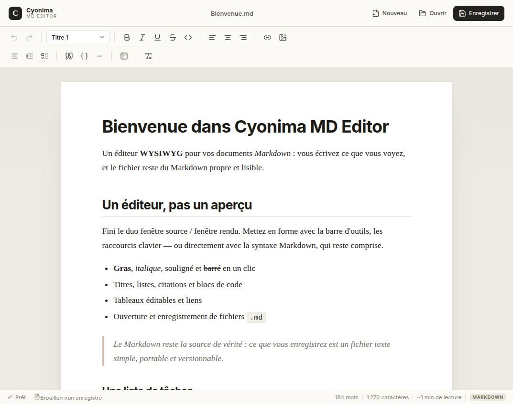

# Cyonima MD Editor

Un éditeur **Markdown WYSIWYG** pour le bureau : on écrit et on met en forme directement dans la page, comme dans un traitement de texte, et le fichier enregistré reste du **Markdown propre et portable**.



## Pourquoi ?

Les éditeurs Markdown classiques séparent l'écriture (le code source) et l'aperçu. Cyonima MD Editor inverse la logique : la page est le document, la barre d'outils fait la mise en forme, et le Markdown est généré à l'enregistrement. Pas de syntaxe à mémoriser, pas de fichier propriétaire.

## Fonctionnalités

- **Édition WYSIWYG** propulsée par Tiptap / ProseMirror.
- **Mise en forme riche** : gras, italique, souligné, barré, code en ligne, titres 1 à 4.
- **Structure** : listes à puces, listes numérotées, listes de tâches, citations, blocs de code, séparateurs.
- **Tableaux éditables** : insertion, ajout/suppression de lignes et de colonnes.
- **Liens et images** : insertion par boîte de dialogue, ouverture des liens avec `Ctrl`/`Cmd` + clic.
- **Fichiers Markdown** : nouveau document, ouverture, enregistrement, « Enregistrer sous ».
- **Export PDF** et impression (mise en page A4, sans l'interface).
- **Statut du document** : nombre de mots, caractères, temps de lecture, chemin du fichier, état d'enregistrement.
- **Garde-fou** : confirmation avant de perdre des modifications non enregistrées, y compris à la fermeture.
- Interface en français, thème clair et typographie de document.

## Démarrage

Prérequis : **Node.js 18+** et npm.

```bash
npm install
npm run dev
```

L'application Electron s'ouvre avec un document vide. Utilisez `Ctrl+N` / `Ctrl+O` / `Ctrl+S`, la barre d'outils, ou les boutons en haut à droite.

### Scripts

| Commande | Rôle |
| --- | --- |
| `npm run dev` | Lance l'application en mode développement (HMR). |
| `npm run dev:web` | Aperçu de l'interface dans un navigateur, avec un mock du système de fichiers. |
| `npm run build` | Vérifie les types et construit l'application dans `out/`. |
| `npm run preview` | Lance la version construite. |
| `npm run dist` | Construit un installeur (AppImage, NSIS ou DMG selon la plateforme). |
| `npm run dist:dir` | Construit un dossier d'application non empaqueté. |
| `npm test` | Lance les tests de conversion Markdown ↔ HTML. |
| `npm run typecheck` | Vérifie les types du processus principal et du rendu. |

## Raccourcis

| Action | Raccourci |
| --- | --- |
| Nouveau document | `Ctrl/Cmd+N` |
| Ouvrir | `Ctrl/Cmd+O` |
| Enregistrer | `Ctrl/Cmd+S` |
| Enregistrer sous | `Ctrl/Cmd+Shift+S` |
| Imprimer | `Ctrl/Cmd+P` |
| Gras / Italique / Souligné | `Ctrl/Cmd+B` / `I` / `U` |
| Barré | `Ctrl/Cmd+Shift+X` |
| Code en ligne | `Ctrl/Cmd+E` |
| Lien | `Ctrl/Cmd+K` |
| Annuler / Rétablir | `Ctrl/Cmd+Z` / `Ctrl/Cmd+Shift+Z` (ou `Ctrl+Y`) |

Les raccourcis Markdown de Tiptap restent disponibles : `#` + espace pour un titre, `-` + espace pour une liste, `>` + espace pour une citation, ` ``` ` pour un bloc de code, etc.

## Architecture

```text
src/
├── main/        Processus principal Electron : fenêtres, menus, dialogues, accès disque
├── preload/     Pont sécurisé (contextBridge) exposant une API typée au rendu
├── renderer/    Interface React + Tiptap
│   ├── components/   En-tête, barre d'outils, barre de statut, dialogues
│   ├── editor/       Extensions Tiptap et conversion Markdown
│   └── lib/          Mock de développement pour l'aperçu navigateur
└── shared/      Types IPC partagés
```

### Conversion Markdown

Le Markdown est la source de vérité, mais il n'est jamais édité directement :

1. **Ouverture** : Markdown → `marked` → HTML → `editor.commands.setContent()`.
2. **Édition** : ProseMirror maintient un document HTML structuré.
3. **Enregistrement** : HTML → `Turndown` → Markdown.

Des règles Turndown dédiées garantissent un rendu propre des tableaux GFM, des listes (y compris imbriquées et de tâches), des blocs de code avec langage, du souligné et des liens. Les tests couvrent ces conversions et vérifient qu'un second aller-retour est stable.

### Sécurité

- `contextIsolation: true`, `sandbox: true`, `nodeIntegration: false`.
- Aucun accès Node.js dans le rendu : tout passe par des canaux IPC explicites.
- Navigation et ouverture de fenêtres bloquées ; les liens externes passent par `shell.openExternal`.
- CSP restrictive dans `index.html`, nettoyage du HTML importé.

## Limites connues

- L'alignement de paragraphe n'a pas d'équivalent Markdown standard : il est visible à l'écran, mais perdu à l'enregistrement.
- Les images sont référencées par URL ou chemin ; les fichiers locaux ne sont pas copiés automatiquement dans un dossier `assets/`.
- Les blocs HTML exotiques (iframes, styles, scripts) sont filtrés à l'ouverture.
- L'ouverture de fichiers via le menu natif « Ouvrir avec » n'est pas encore gérée lorsqu'une instance est déjà lancée.

## Feuille de route

Les chantiers prévus, leur priorité et l'ordre recommandé sont détaillés dans **[roadmap.md](roadmap.md)**.

En résumé : fiabiliser la conservation des fichiers (frontmatter, autosave), puis le confort quotidien (recherche, images locales, thème sombre), les fonctions Markdown avancées, l'organisation multi-documents, et enfin la distribution signée.

## Licence

MIT.
